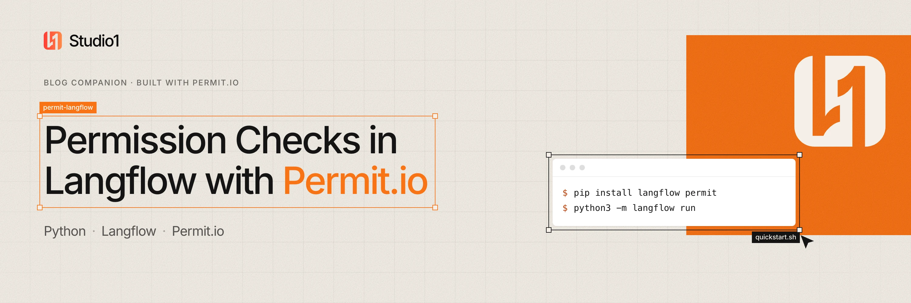

<div align="center">



<br />
<br />

# Permission Checks in Langflow with Permit.io

### A Langflow chain gated by a Permit.io permission check

A Langflow flow and custom Python component that check a user's role with Permit.io before a prompt reaches the LLM, and return an access-denied message otherwise.

<br />

[![Built by Studio1](https://img.shields.io/badge/Built_by_Studio1-f97316?style=for-the-badge&logo=data%3Aimage%2Fsvg%2Bxml%3Bbase64%2CPHN2ZyB4bWxucz0iaHR0cDovL3d3dy53My5vcmcvMjAwMC9zdmciIHZpZXdCb3g9IjAgMCAxNjAgMTYwIiBmaWxsPSJub25lIj48cGF0aCBmaWxsLXJ1bGU9ImV2ZW5vZGQiIGNsaXAtcnVsZT0iZXZlbm9kZCIgZD0iTTAgMzVDMCAxNi42ODA3IDE0LjA3NDQgMS42NDg0NCAzMiAwLjEyNjk1M1YxNDFINTEuMDUyM0M1Mi40MzA4IDEzNy4zNDQgNTQuNzQ0NiAxMzMuNjg5IDU3Ljk5MzggMTMwLjAzM0M2MS4xNDQ2IDEyNi41MDggNjQuNjg5MiAxMjMuNDQgNjguNjI3NyAxMjAuODI5QzcyLjU2NjIgMTE4LjM0OSA3Ni4zNTY5IDExNi43ODIgODAgMTE2LjEyOVY4Ni43NTQ0Qzc1LjQ3MDggODcuOTI5MiA3MS4zODQ2IDg5LjY5MTkgNjcuNzQxNSA5Mi4wNDE1QzY0IDk0LjUyMjUgNjAuNzUwOCA5Ny40NiA1Ny45OTM4IDEwMC44NTRDNTYuNTM0NSAxMDIuNzIgNTUuMjU0NSAxMDQuNjU5IDU0LjE1MzkgMTA2LjY3MVYwSDEyNUMxNDQuMzMgMCAxNjAgMTUuNjY5OSAxNjAgMzVWMTI1QzE2MCAxNDQuMzMgMTQ0LjMzIDE2MCAxMjUgMTYwSDEyNFYxOEgxMDQuOTQ4QzEwMy41NjkgMjEuNjgxNiAxMDEuMjU1IDI1LjM2MjggOTguMDA2MiAyOS4wNDQ0Qzk0Ljg1NTQgMzIuNTk0MiA5MS4zMTA4IDM1LjY4NDEgODcuMzcyMyAzOC4zMTRDODMuNDMzOCA0MC44MTIgNzkuNjQzMSA0Mi4zODk2IDc2IDQzLjA0NzRWNzIuNjMwNEM4MC41MjkyIDcxLjQ0NzMgODQuNjE1NCA2OS42NzI0IDg4LjI1ODUgNjcuMzA1N0M5MiA2NC44MDc2IDk1LjI0OTIgNjEuODQ5MSA5OC4wMDYyIDU4LjQzMDdDOTkuNDY1NSA1Ni41NTEzIDEwMC43NDUgNTQuNTk4NiAxMDEuODQ2IDUyLjU3MjNWMTYwSDM1QzE1LjY3IDE2MCAwIDE0NC4zMyAwIDEyNVYzNVoiIGZpbGw9IiNmZmZmZmYiLz48L3N2Zz4K)](https://studio1hq.com)
[](https://permit.io)
[](https://astrodevil.medium.com/manage-permissions-in-a-langflow-chain-for-llm-queries-using-permit-io-7de8a0fb17b3)
[](https://astrodevil.medium.com/manage-permissions-in-a-langflow-chain-for-llm-queries-using-permit-io-7de8a0fb17b3)

[Permit.io docs](https://docs.permit.io) &nbsp;·&nbsp; [Permit.io](https://permit.io) &nbsp;·&nbsp; [More examples](https://github.com/Studio1HQ) &nbsp;·&nbsp; [studio1hq.com](https://studio1hq.com)

</div>

<br />

## Overview

A Langflow chain gated by Permit.io. A custom Python component checks a user's permission before the prompt reaches the LLM. If the check passes, the prompt goes on to the chain. If not, the component returns a message saying the user has no access to the chatbot.

The authorization model is role-based (RBAC): the component calls `permit.check(user, action, resource)` against a Permit.io PDP that you run locally with Docker. The component holds a small user list (John, Max, Siddhesh) that maps names to Permit.io user keys.

## Features

- **Permission gate for prompts**: Blocks an LLM query unless the user is permitted.
- **Custom Langflow component**: `PermissionCheckComponent` with inputs for user ID, action, resource (model), prompt and PDP URL.
- **Importable chain**: `Permit + Langflow.json` loads the flow on the canvas.
- **Local PDP**: Permission checks run against a PDP URL you control.
- **Clear outcomes**: Returns the original prompt, or a denial message.

## Tech stack

| Layer | Tool |
| --- | --- |
| Flow builder | [Langflow](https://www.langflow.org) |
| Authorization | [Permit.io](https://permit.io) RBAC (`permit` SDK, local PDP) |
| Language | Python 3.8+ |

## Getting started

### Prerequisites

- Python 3.8 or higher
- Docker (for the local PDP)
- A [Permit.io](https://permit.io) account and API key
- An API key for the LLM you choose in the chain

### Installation

```bash
git clone https://github.com/Studio1HQ/Permit-Langflow.git
cd Permit-Langflow
pip install langflow
pip install permit
```

### Environment variables

The component takes its values as inputs in the Langflow UI rather than from environment variables:

| Input | Description |
| --- | --- |
| User ID | User name to check. Must match an entry in the component's user list. |
| Action | The action to check, for example `write`. |
| Model (resource) | The resource the user wants to access. |
| PDP URL | URL of your local Permit.io PDP. |

`CustomComponent.py` currently has a Permit.io API key written into the code. Replace it with your own key, and move it out of source control.

### Run

Start Langflow:

```bash
python3 -m langflow run
```

Then in the web interface:

1. Open the local URL that Langflow prints.
2. Click Import Chain and select `Permit + Langflow.json`. The chain appears on the canvas.
3. Run the Permit.io PDP locally with Docker so permission checks happen on your machine, and note its URL.
4. Add a Custom Component node, click its code button, and paste the contents of `CustomComponent.py`.
5. Enter the PDP URL, your Permit.io API key and the LLM model key.
6. Connect the component's output to the rest of the chain, then run queries.

## How it works

```text
user, action, resource, prompt
        |
PermissionCheckComponent -> permit.check(user, action, resource) via the PDP
        |
allowed  -> prompt passes to the LLM chain
denied   -> "User <name> do not access to the Chat Bot" message
```

The component looks up the user by name, runs the check, and returns the prompt or the denial text. Missing inputs, unknown users and PDP errors each return an error message.

## Resources

- [Manage Permissions in a Langflow Chain for LLM Queries Using Permit.io](https://astrodevil.medium.com/manage-permissions-in-a-langflow-chain-for-llm-queries-using-permit-io-7de8a0fb17b3): The blog post for this project.
- [Permit.io docs](https://docs.permit.io): RBAC, the PDP and SDKs.
- [Permit.io](https://permit.io): Account and API key.

<br />

---

<div align="center">

<a href="https://studio1hq.com">
  <picture>
    <source media="(prefers-color-scheme: dark)" srcset="https://raw.githubusercontent.com/Studio1HQ/website/main/brand/studio1-logo-on-dark.svg" />
    
  </picture>
</a>

Built by **[Studio1](https://studio1hq.com)**, the technical content and DevRel partner for devtool teams. Made with [Permit.io](https://permit.io).<br />
Browse more open-source examples at [github.com/Studio1HQ](https://github.com/Studio1HQ).

[](https://studio1hq.com)
[](https://cal.com/studio1/collab)
[](https://x.com/Studio1HQ)
[](https://www.linkedin.com/company/studio1hq/)

<sub><a href="https://studio1hq.com">studio1hq.com</a> · Technical content, docs, video and DevRel for devtools</sub>

</div>
